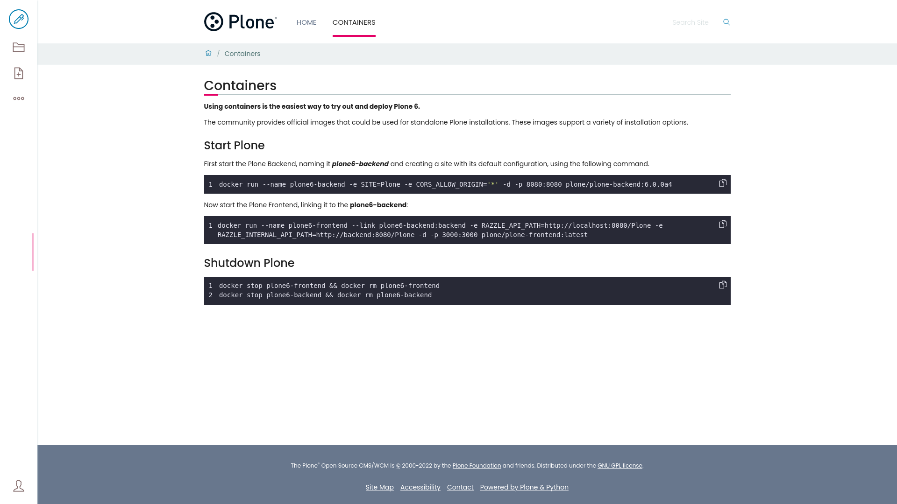
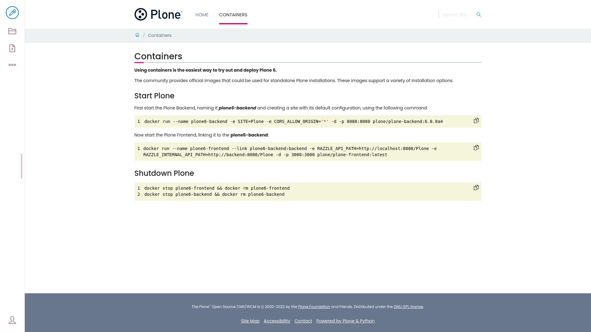

# Code Block for Volto (@plonegovbr/volto-code-block)

Addon implementing a code block with syntax highlight for [Plone](https://plone.org) projects with [Volto](https://github.com/plone/volto).

[](https://www.npmjs.com/package/@plonegovbr/volto-code-block)
[](https://plonegovbr.github.io/volto-code-block/)
[](https://github.com/plonegovbr/volto-code-block/actions/workflows/main.yml)

## Features

- **Code Block** (`codeBlock`): source code with syntax highlighting, line numbers and a caption.
- **Mermaid Diagram** (`mermaidBlock`): diagrams rendered from their text definition.
- **Gist Block** (`gistBlock`): embedded GitHub Gists.

All blocks are also available inside the grid and accordion blocks, and they are documented for the [`@blocks-schema` endpoint](https://6.docs.plone.org/volto/reference/blocks-schema-endpoint.html) of Volto 19.6 and later.

## Screenshots

### Code Block with Dark style



### Code Block with Light style



## Examples

@plonegovbr/volto-code-block can be seen in action at the following sites:

- [Plone Brasil](https://plone.org.br)

You can also check its [Storybook](https://plonegovbr.github.io/volto-code-block/).

### Configure language available in the block setting

You can specify the languages available in the block settings by modifying the object in `config.settings.codeBlock.languages`, in the configuration of your project or add-on. Each item is composed of an object containing:

* label: Friendly name for the language. i.e.: Python
* language: Reference to `prismjs` language component.


Example:

```typescript
import type { ConfigType } from '@plone/registry';
import { languages } from '@plonegovbr/volto-code-block';

import 'prismjs/components/prism-bash';
import 'prismjs/components/prism-clike';
import 'prismjs/components/prism-css';
import 'prismjs/components/prism-docker';
import 'prismjs/components/prism-javascript';
import 'prismjs/components/prism-json';
import 'prismjs/components/prism-less';
import 'prismjs/components/prism-markdown';
import 'prismjs/components/prism-markup';
import 'prismjs/components/prism-nginx';
import 'prismjs/components/prism-python';
import 'prismjs/components/prism-scss';
import 'prismjs/components/prism-yaml';

const applyConfig = (config: ConfigType) => {
    config.settings['codeBlock'] = {
        languages: {
        bash: { label: 'Bash', language: languages.bash },
        css: { label: 'CSS', language: languages.css },
        dockerfile: { label: 'Dockerfile', language: languages.dockerfile },
        javascript: { label: 'Javascript', language: languages.js },
        json: { label: 'JSON', language: languages.json },
        less: { label: 'LESS', language: languages.less },
        markdown: { label: 'Markdown', language: languages.markdown },
        nginx: { label: 'nginx', language: languages.nginx },
        python: { label: 'Python', language: languages.python },
        scss: { label: 'SCSS', language: languages.scss },
        yaml: { label: 'Yaml', language: languages.yaml },
        xml: { label: 'XML', language: languages.xml },
        },
    };

    return config;
};

export default applyConfig;
```

## Installation

This add-on is developed and tested with Volto 19.6. The `@blocks-schema` endpoint, which serves the documentation of its blocks, requires Volto 19.6.0 or later.

Add `@plonegovbr/volto-code-block` to your `package.json`:

```json
"dependencies": {
    "@plonegovbr/volto-code-block": "*"
}
```

Add `@plonegovbr/volto-code-block` to your `volto.config.js`:

```javascript
const addons = ['@plonegovbr/volto-code-block'];
```

Install the dependencies and start Volto:

```shell
pnpm install
pnpm start
```

## Test installation

Visit http://localhost:3000/ in a browser, log in, edit a page, and add a **Code Block**, **Mermaid Diagram** or **Gist Block** from the text group of the block chooser.


## Development

The development of this add-on is done in isolation using pnpm workspaces, `mrs-developer` and a checkout of Volto core.
For this reason, it only works with pnpm.


### Prerequisites ✅

-   An [operating system](https://6.docs.plone.org/install/create-project-cookieplone.html#prerequisites-for-installation) that runs all the requirements mentioned.
-   [nvm](https://6.docs.plone.org/install/create-project-cookieplone.html#nvm)
-   [Node.js and pnpm](https://6.docs.plone.org/install/create-project.html#node-js) 24
-   [Make](https://6.docs.plone.org/install/create-project-cookieplone.html#make)
-   [Git](https://6.docs.plone.org/install/create-project-cookieplone.html#git)
-   [Docker](https://docs.docker.com/get-started/get-docker/) (optional)

### Installation 🔧

1.  Clone this repository, then change your working directory.

    ```shell
    git clone git@github.com:plonegovbr/volto-code-block.git
    cd volto-code-block
    ```

2.  Install this code base.

    ```shell
    make install
    ```


### Make convenience commands

Run `make help` to list the available commands.

```text
help                             Show this help
install                          Installs the add-on in a development environment
start                            Starts Volto, allowing reloading of the add-on during development
build                            Build a production bundle for distribution of the project with the add-on
i18n                             Sync i18n
ci-i18n                          Check if i18n is not synced
format                           Format codebase
lint                             Lint, or catch and remove problems, in code base
typecheck                        Type check the add-on with tsc
release                          Release the add-on on npmjs.org
release-dry-run                  Dry-run the release of the add-on on npmjs.org
test                             Run unit tests
ci-test                          Run unit tests in CI
backend-docker-start             Starts a Docker-based backend for development
storybook-start                  Start Storybook server on port 6006
storybook-build                  Build Storybook
acceptance-frontend-dev-start    Start acceptance frontend in development mode
acceptance-frontend-prod-start   Start acceptance frontend in production mode
acceptance-backend-start         Start backend acceptance server
ci-acceptance-backend-start      Start backend acceptance server in headless mode for CI
acceptance-test                  Start Cypress in interactive mode
ci-acceptance-test               Run cypress tests in headless mode for CI
```

### Development environment set up

Install package requirements.

```shell
make install
```

### Start developing

Start the backend.

```shell
make backend-docker-start
```

In a separate terminal session, start the frontend.

```shell
make start
```

### Lint code

Run ESlint, Prettier, Stylelint and the type check in analyze mode.

```shell
make lint
```

### Format code

Run ESlint, Prettier, and Stylelint in fix mode.

```shell
make format
```

### Type check

Run `tsc` on the add-on.

```shell
make typecheck
```

### i18n

Extract the i18n messages to locales.

```shell
make i18n
```

### Unit tests

Run unit tests.

```shell
make test
```

### Run Cypress tests

Run each of these steps in separate terminal sessions.

In the first session, start the frontend in development mode.

```shell
make acceptance-frontend-dev-start
```

In the second session, start the backend acceptance server.

```shell
make acceptance-backend-start
```

In the third session, start the Cypress interactive test runner.

```shell
make acceptance-test
```

## Documenting blocks

Each block has a `docs.block.md` next to its schema, which Volto serves through the `@blocks-schema` endpoint.
When you change the fields of a block, update this file too: `src/components/Blocks/docs.test.ts` fails when the documentation and the schema disagree.

## License

The project is licensed under the MIT license.

## Credits and acknowledgements 🙏

Generated using [Cookieplone](https://github.com/plone/cookieplone), and aligned with [cookieplone-templates (feb3bcf)](https://github.com/plone/cookieplone-templates/commit/feb3bcf). A special thanks to all contributors and supporters!
